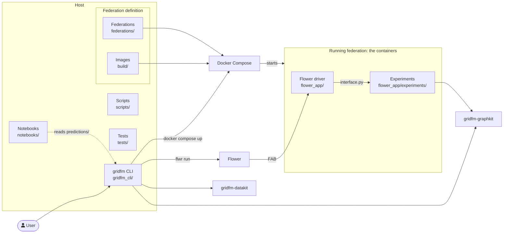

# 5. Building Block View

The building blocks are the folders at the root of the repository:

- The gridfm CLI in `gridfm_cli/` is what the user runs on the host.
- The Flower driver in `flower_app/` is the code that runs in the containers of a
  federation.
- The experiments in `flower_app/experiments/` are the training procedures the driver
  runs.
- The federations in `federations/` and the images in `build/` define what Docker
  Compose starts.
- The scripts, notebooks and tests support the work around a run.

## 5.1 Whitebox Overall System

The boxes outside the two groups are third-party software:

- Flower, which the gridfm CLI submits runs to and which the driver is built on.
- Docker Compose, which the gridfm CLI runs with a federation's Compose file.
- gridfm-datakit, which the gridfm CLI generates the client data with.
- gridfm-graphkit, which the experiments and the gridfm CLI build the model with.

The contained building blocks are:

| Name          | Responsibility                                                                                             | Code                      |
| ------------- | ---------------------------------------------------------------------------------------------------------- | ------------------------- |
| gridfm CLI    | Generates data, starts and stops federations, submits runs and predicts with finished runs, on the host.   | `gridfm_cli/`             |
| Flower driver | The ServerApp and ClientApp entry points, which look up the experiment named in the run config and run it. | `flower_app/`             |
| Experiments   | One package per training procedure: the model, its configuration and the server and client code.           | `flower_app/experiments/` |
| Federations   | One folder per federation: a gridfm-datakit config per client, the generated data and the Compose file.    | `federations/`            |
| Images        | The Dockerfiles and dependency lists of the ServerApp and ClientApp images.                                | `build/`                  |
| Scripts       | Standalone scripts that run on the host, such as builders of custom grids.                                 | `scripts/`                |
| Notebooks     | marimo notebooks that plot the results of runs.                                                            | `notebooks/`              |
| Tests         | pytest tests of the code that runs without the Docker images.                                              | `tests/`                  |

The interfaces between the blocks that matter for understanding the whole are:

| Interface            | Between                                 | Form                                                                                                                                                                        |
| -------------------- | --------------------------------------- | --------------------------------------------------------------------------------------------------------------------------------------------------------------------------- |
| Experiment interface | Flower driver and Experiments           | `interface.py`: an `Experiment` of three entry points, `server_main`, `client_train` and `client_evaluate`, which receive `ServerPaths`, `ClientPaths` and `ClientDataset`. |
| Run config           | gridfm CLI and Flower driver            | The `experiment` key and the experiment's own keys, declared with defaults in `pyproject.toml` and passed by `flwr run`.                                                    |
| Node config          | Federations and Flower driver           | The `--node-config` of each SuperNode in `compose.yml`, which the driver turns into the client's `ClientDataset`.                                                           |
| Run folder           | Experiments and gridfm CLI              | `outputs/<federation>/<experiment>/<timestamp>/` with `metrics.json`, and for experiments that save a model, `final_model.pt` and `graphkit_config.json`.                   |
| Data folder          | gridfm CLI, Federations and Experiments | `federations/<name>/data/client_<i>/<network>/`, written by gridfm-datakit on the host and mounted into the client's container.                                             |

### 5.1.1 gridfm CLI

The `gridfm` command is the only thing a user runs. It:

- generates and deletes client data with gridfm-datakit
- wraps `docker compose` to start and stop a federation
- submits runs with `flwr run`
- finds and prompts for federations, experiments and runs
- rebuilds a finished run's model with gridfm-graphkit from the run's
  `graphkit_config.json` and `final_model.pt`, and predicts the scenarios of the
  federation's clients on the host

It writes the predictions to `predictions/`. It provides the command-line interface to
the user and requires the run config, the run folder and the data folder.

### 5.1.2 Flower Driver

The root of `flower_app/` holds the code that the FAB ships to the server and the
clients, apart from the experiments. It consists of the ServerApp and ClientApp entry
points, which look up the experiment named in the run config and call its entry points,
the conversion of a SuperNode's node config into the client's dataset description, and
the fixed paths inside the containers. The entry points are set in
`[tool.flwr.app.components]` of `pyproject.toml`.

`interface.py` defines the types the driver and the experiments share. `Experiment`
bundles an experiment's entry points, the protocols `ServerMain` and `ClientHandler`
describe what those entry points look like, and `ServerPaths`, `ClientPaths` and
`ClientDataset` are what the driver passes to them. The driver provides the experiment
interface and requires the run config and the node config.

### 5.1.3 Experiments

Each experiment is a package `flower_app/experiments/<name>/`, registered by name in
`EXPERIMENTS` of `flower_app/experiments/__init__.py`. The package defines an
`EXPERIMENT` with a server main, run once per run, and client train and evaluate
handlers, run once per message. It holds its gridfm-graphkit configuration as
`GRAPHKIT_CONFIG` and builds the gridfm-graphkit task, the data module and the trainer
from it. An experiment implements the experiment interface, reads the data folder and
writes the run folder.

### 5.1.4 Federations

Each folder `federations/<name>/` defines one federation. `datakit_config/` holds one
gridfm-datakit config per client, `data/` the data generated from them, and
`compose.yml` the federation's containers. In the Compose file, the node config of each
SuperNode, the settings Flower gives that SuperNode, tells its client where its data is
and which networks it contains. A federation provides the node config and the data
folder.

### 5.1.5 Images

`build/server/` and `build/client/` hold the Dockerfiles and dependency lists of the
ServerApp and ClientApp images. Docker Compose builds the images from them.

### 5.1.6 Scripts

`scripts/` holds standalone scripts that run on the host, such as builders of custom
grids in the [MATPOWER](https://matpower.org/) case format and of load profiles.

### 5.1.7 Notebooks

`notebooks/` holds marimo notebooks that look at the results of runs. `scenarios.py`
draws one scenario of one client as a network, with the model's input, the power flow
solution, the prediction and the error, using the files that `gridfm predict` writes to
`predictions/`. The notebooks read the predictions and the data folder.

### 5.1.8 Tests

`tests/` holds pytest tests of the code that runs without the Docker images. The Python
library [torch_scatter](https://github.com/rusty1s/pytorch_scatter), which
gridfm-graphkit imports, is installed on the host as well as in the images, so tests can
import the experiments.
