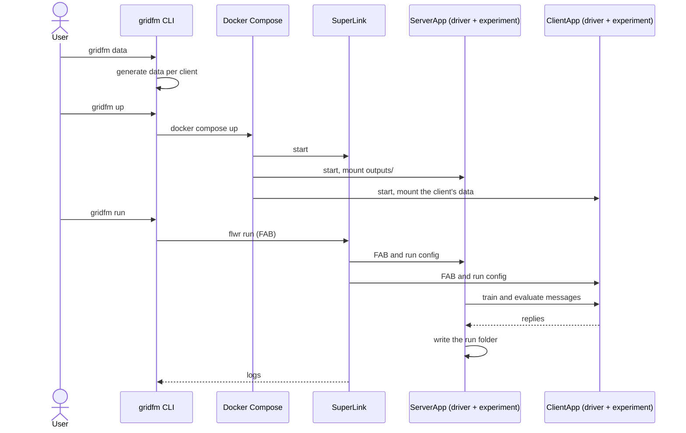
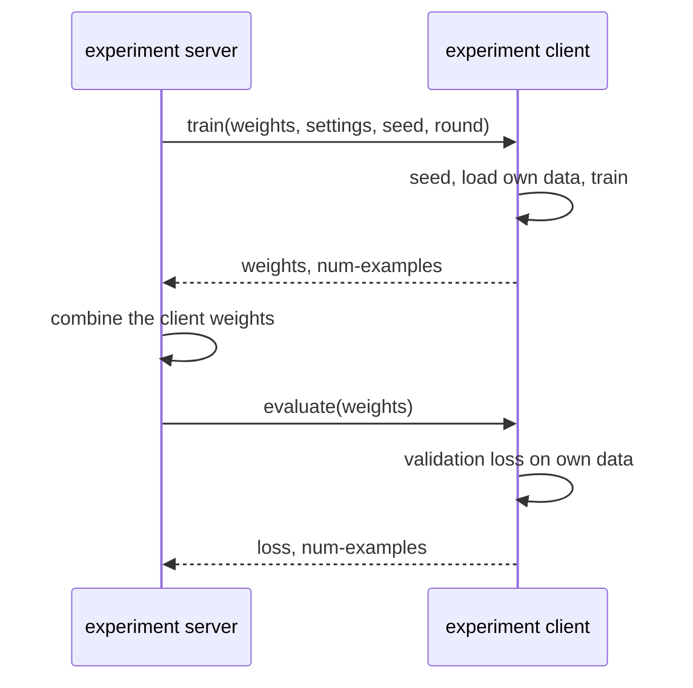

# 6. Runtime View

Three scenarios cover the life of a model in the demo. The first runs an experiment from
data generation to the metrics on the host, and shows how the gridfm CLI, Docker Compose
and Flower hand over to each other. The second is one training round of a federated
experiment, which shows what crosses the boundary between the server and a client. The
third rebuilds a finished run's model on the host and predicts with it. Each scenario
ends with the failures the gridfm CLI catches.

## 6.1 Run an Experiment End to End

The user runs `gridfm data`, `gridfm up` and `gridfm run`:

1. `gridfm data <federation>` reads the federation's gridfm-datakit configs and
   generates each client's dataset on the host, into `federations/<federation>/data/`.
   Clients that already have data are skipped.
2. `gridfm up <federation>` checks that every client has data, creates the federation's
   folder under `outputs/` so Docker does not create it as root, and runs
   `docker compose up -d --build` with the federation's Compose file.
3. Docker Compose builds the ServerApp and ClientApp images from `build/` if needed and
   starts the containers: the SuperLink, one SuperNode and one ClientApp per client, and
   the ServerApp. Each ClientApp mounts only its own client's data, and the ServerApp
   mounts the federation's output folder.
4. `gridfm run <experiment>` checks that the SuperLink accepts connections and runs
   `flwr run . local-deployment --run-config "experiment='<experiment>'" --stream`.
5. `flwr run` bundles `flower_app/` into a FAB and submits it to the SuperLink, which
   passes it on to the SuperNodes. The ServerApp and every ClientApp load the FAB.
6. The Flower driver on the server reads the experiment's name from the run config and
   calls the experiment's server main with a `ServerPaths` that points at the run's
   output folder, `outputs/<federation>/<experiment>/<timestamp>/` on the host.
7. The experiment's server main runs its rounds, as the next scenario shows, and writes
   its metrics to the output folder. An experiment that trains one shared model also
   writes the model and the configuration it was built from.
8. `flwr run` streams the run's logs to the user until the run ends.

The notable aspect is the three hand-overs. The gridfm CLI starts each stage and checks
its precondition first, which is what makes the demo one command per step. Docker
Compose turns the federation's folder into running containers, and from then on the CLI
reaches the federation only through the SuperLink. Flower delivers the project's code
last, with the run, so the containers are generic until a run arrives. The failures the
CLI catches are:

| Step | Failure                                     | Response                                                                                 |
| ---- | ------------------------------------------- | ---------------------------------------------------------------------------------------- |
| 2    | A client has no generated data              | `gridfm up` exits with code 1 and names the clients and the command that generates data. |
| 4    | No SuperLink accepts connections            | `gridfm run` exits with code 1 and names the command that starts a federation.           |
| 5    | A run config key is not in `pyproject.toml` | `flwr run` rejects the run before it starts. Keys must be declared with a default.       |

## 6.2 One Training Round

The server main of an experiment that trains one shared model starts a round:

1. Before the first round, the server seeds its random number generators from the `seed`
   run config key and builds the initial model from `GRAPHKIT_CONFIG`.
2. The server sends a train message to every client with the global weights and a config
   holding the client's training settings, the seed and the round number.
3. Each client seeds from the seed, the round and its client ID, loads its own data from
   the `ClientDataset` the driver built, and trains the model with a Lightning trainer.
4. Each client replies with its weights and its number of training examples.
5. The server combines the client weights into the new global model, as its strategy
   prescribes.
6. The server sends an evaluate message with the new global weights to every client.
7. Each client computes its validation loss on its own data and replies with the loss
   and its number of validation examples.
8. The server records the metrics of the round. After the last round it writes
   `metrics.json`, `final_model.pt` and `graphkit_config.json` to the run folder.

The notable aspect is what crosses the boundary between the server and a client: model
weights, a few settings and metrics, with Flower routing the messages. The data stays in
the client's container, which is the quality goal Secure. The seed travels with every
train message and each client mixes in the round and its client ID, which is what makes
runs with the same seed repeat, the quality goal Reliable. The failures that show in the
ClientApp container's log are:

| Step | Failure                               | Response                                                                           |
| ---- | ------------------------------------- | ---------------------------------------------------------------------------------- |
| 3    | The node config lacks a key           | The driver raises an error naming the key.                                         |
| 3    | The client's data is missing or stale | gridfm-graphkit regenerates the client's `processed/` folder inside the container. |

## 6.3 Predict on the Host

The user runs `gridfm predict <federation> <experiment>/<timestamp>`:

1. The gridfm CLI resolves the run to `outputs/<federation>/<experiment>/<timestamp>/`
   and checks that it holds `final_model.pt` and `graphkit_config.json`.
2. It rebuilds the gridfm-graphkit model from `graphkit_config.json` and loads the
   weights from `final_model.pt`.
3. For each client of the federation, read from the Compose file, it loads the client's
   data from `federations/<federation>/data/` and predicts every scenario.
4. It writes one Parquet file per client to
   `predictions/<federation>/<experiment>/<timestamp>/`, replacing earlier files.

The notable aspect is that the federation plays no part. The gridfm CLI rebuilds the
model from the run folder alone, which is why a run must save the configuration next to
the weights, and it reads the clients and their data from the federation's folder on the
host. The failures the CLI catches are:

| Step | Failure                                        | Response                                                                                               |
| ---- | ---------------------------------------------- | ------------------------------------------------------------------------------------------------------ |
| 1    | The run lacks a model file                     | Exit code 1. Only experiments that save a model can be predicted, and older runs must be run again.    |
| 3    | A client's `processed/` folder belongs to root | Exit code 1 with the file that cannot be written and how to change its owner or regenerate the folder. |
