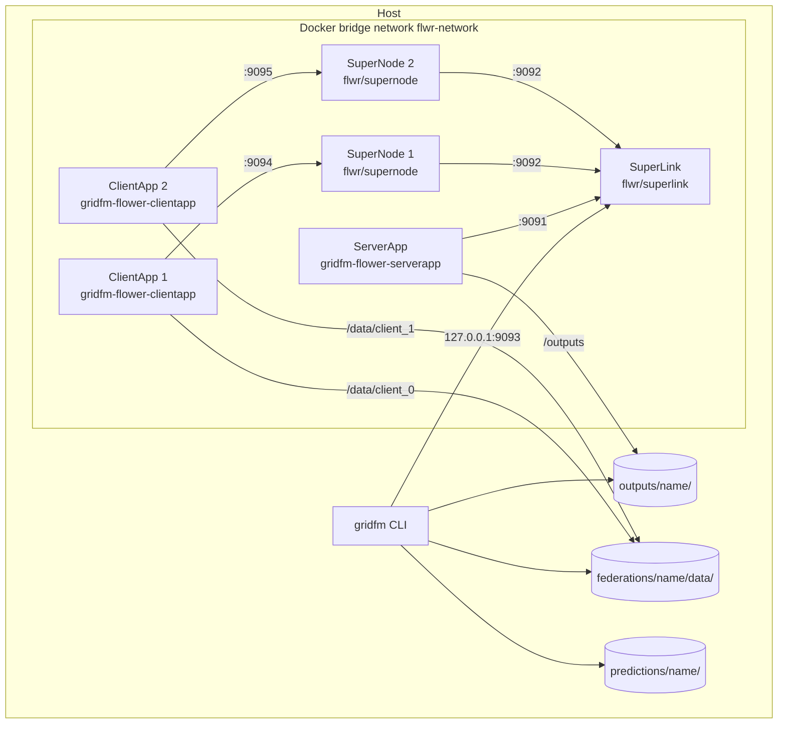

# 7. Deployment View

The whole demo runs on one machine, in one environment. The host runs the gridfm CLI,
the notebooks and the tests, and Docker Compose starts the federation from its folder as
containers on a private bridge network. In a real federation, the server and each client
would run on different machines, and the containers of this demo stand in for them.

Flower separates a federation into long-running infrastructure components and
short-lived apps
([Flower architecture](https://flower.ai/docs/framework/explanation-flower-architecture.html)).
The infrastructure components start with the federation and keep running across any
number of runs. The apps contain the code of this project and run once per run.

- The SuperLink runs on the server. It accepts runs and routes messages between the
  server and the clients.
- A SuperNode runs on each client. It connects to the SuperLink and holds the client's
  node config.
- The ServerApp runs next to the SuperLink and coordinates the training.
- A ClientApp runs next to each SuperNode and trains on that client's data.

## 7.1 Infrastructure Level 1

The diagram shows a federation with two clients. A federation with more clients adds one
SuperNode and one ClientApp per client. The nodes are:

| Node           | Kind                                | Purpose                                                      | Count            |
| -------------- | ----------------------------------- | ------------------------------------------------------------ | ---------------- |
| Host           | Developer machine                   | Runs the gridfm CLI, Docker, the notebooks and the tests     | 1                |
| SuperLink      | Container `flwr/superlink`          | Accepts runs and routes messages between server and clients  | 1 per federation |
| SuperNode      | Container `flwr/supernode`          | Connects a client to the SuperLink and holds its node config | 1 per client     |
| ServerApp      | Container, image in `build/server/` | Runs the FAB's server side                                   | 1 per federation |
| ClientApp      | Container, image in `build/client/` | Runs the FAB's client side on one client's data              | 1 per client     |
| `flwr-network` | Docker bridge network               | Connects the containers of one federation                    | 1 per federation |

This structure is Flower's
[Docker deployment](https://flower.ai/docs/framework/docker/tutorial-quickstart-docker-compose.html)
in the process isolation mode, in which each app runs in its own container and the
SuperLink and SuperNodes are explicit services. It was chosen because it is the
deployment Flower documents and because one container per app makes each client's data
mount explicit: each ClientApp mounts only its own client's folder, which is what the
demo shows. The ServerApp mounts `outputs/<federation>/` from the host as `/outputs` and
writes each run to `/outputs/<experiment>/<timestamp>/`. The containers run as root, so
the run folders belong to root on the host.

The infrastructure provides and limits these qualities:

- The only published port is the SuperLink's run submission port 9093, bound to
  `127.0.0.1`, so nothing outside the host can reach the federation.
- All Flower connections use `--insecure`, that is, no TLS and no client authentication,
  which is acceptable because every endpoint is on one machine.
- Each ClientApp sets `OMP_NUM_THREADS` and `MKL_NUM_THREADS` to 1. PyTorch otherwise
  starts one thread per host core in every ClientApp, and the ClientApps oversubscribe
  the CPU while training tiny graphs.
- A federation's Compose file can reserve the host's NVIDIA GPU for its ClientApps,
  which then share it. The experiments train on a GPU when the ClientApp can see one,
  and on the CPU otherwise.
- The Flower federation `local-deployment` in `pyproject.toml` points the gridfm CLI at
  the SuperLink's published port.

The building blocks map to the infrastructure as follows:

| Building Block | Infrastructure Element                                                |
| -------------- | --------------------------------------------------------------------- |
| gridfm CLI     | Host                                                                  |
| Flower driver  | ServerApp and every ClientApp, delivered in the FAB with each run     |
| Experiments    | ServerApp and every ClientApp, delivered in the FAB with each run     |
| Federations    | Host, with each client's `data/client_<i>` mounted into its ClientApp |
| Images         | Built on the host by Docker Compose, which `gridfm up` runs           |
| Scripts        | Host                                                                  |
| Notebooks      | Host                                                                  |
| Tests          | Host                                                                  |
